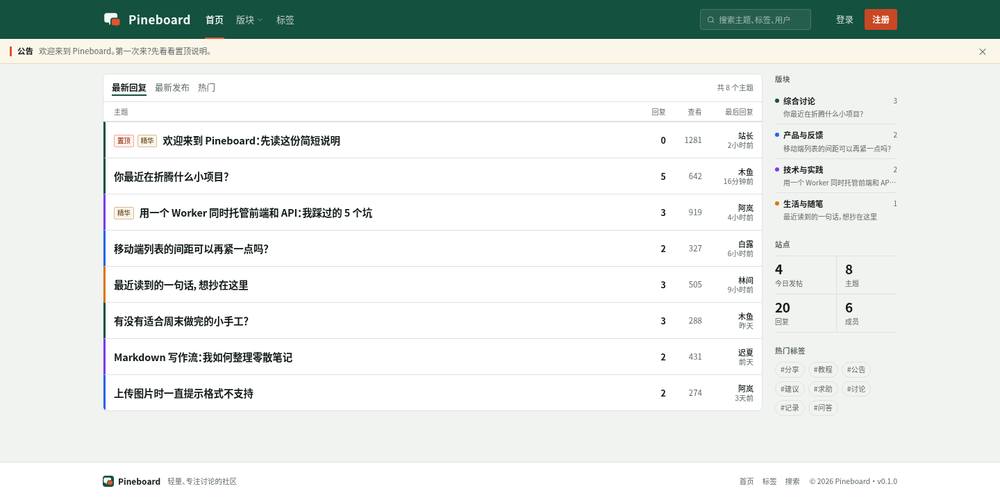
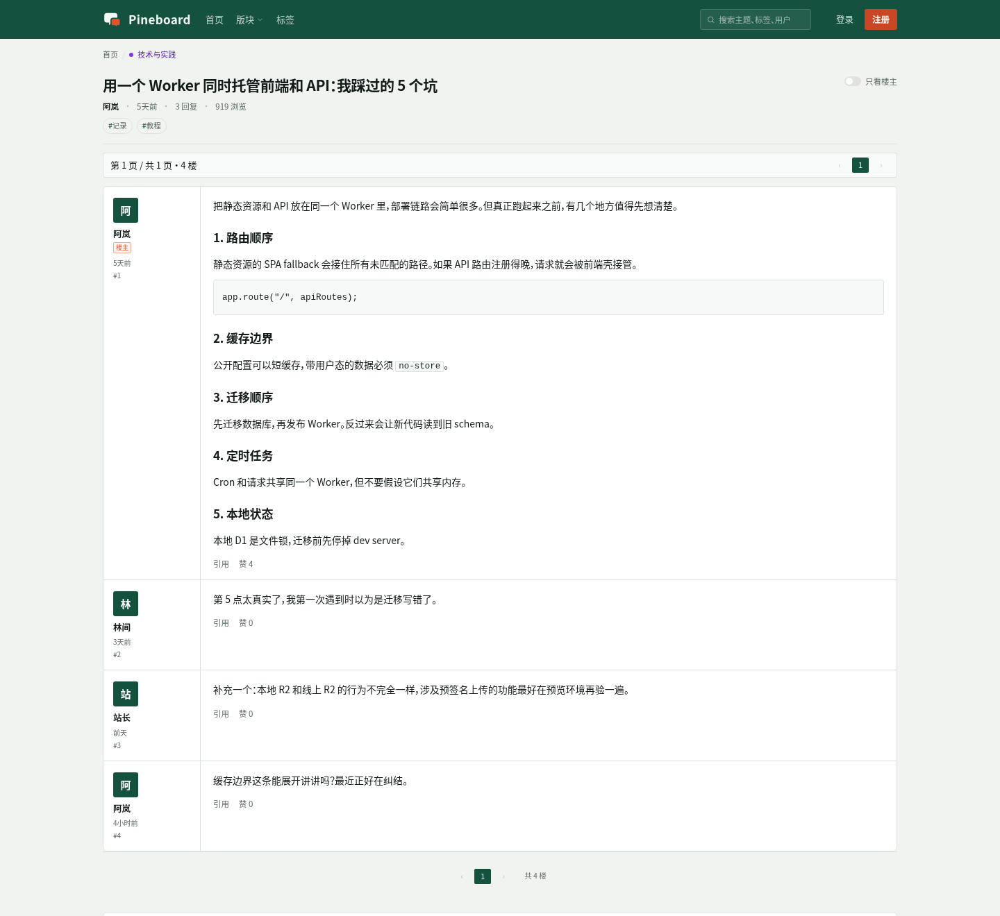
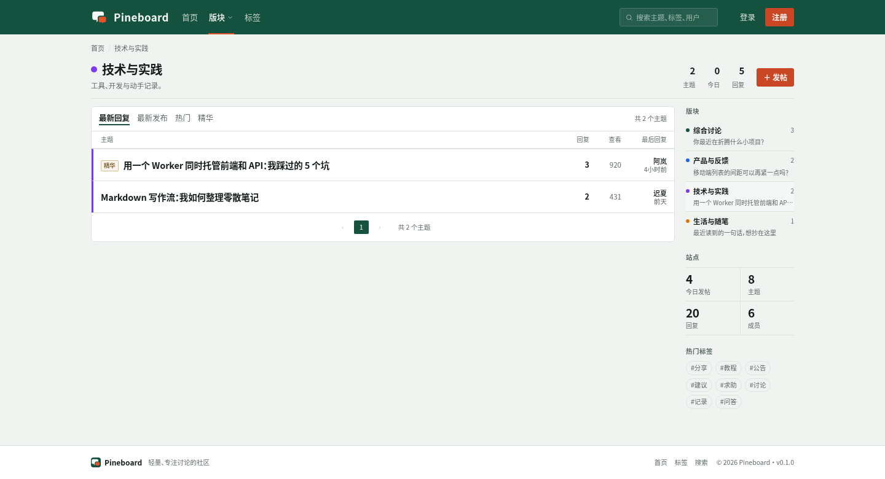
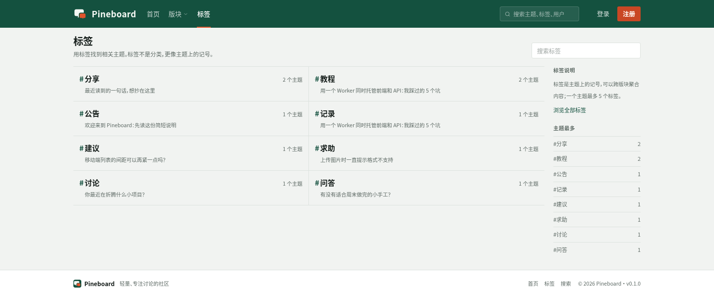
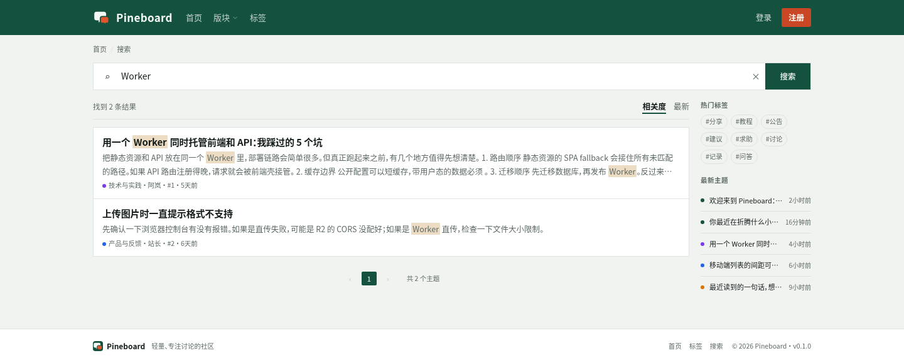
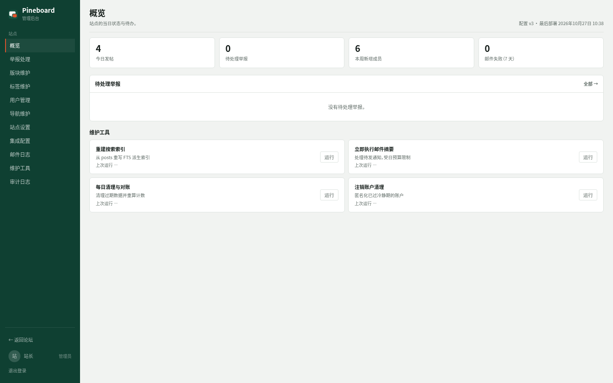
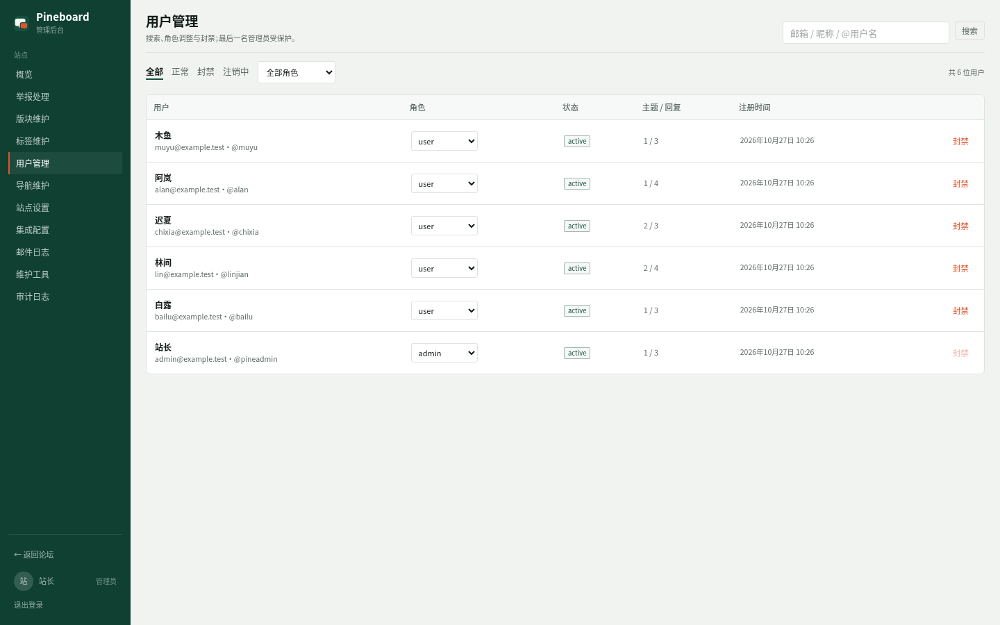
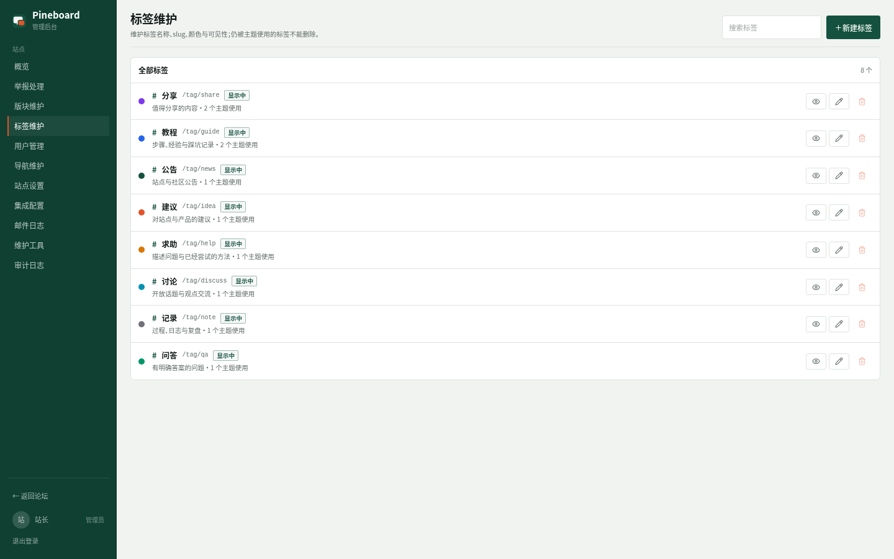
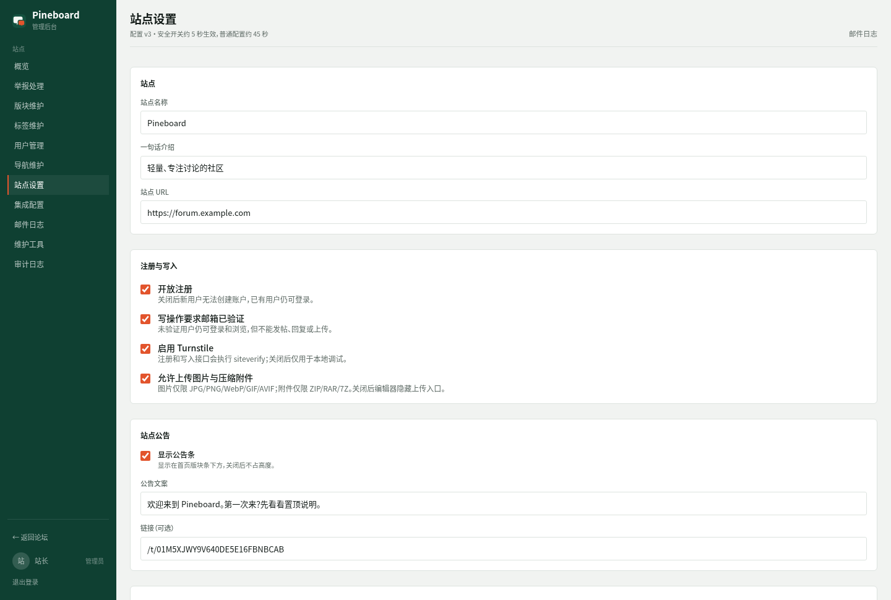

# Pineboard

English | [简体中文](README.zh-CN.md)

A general-purpose, lightweight forum that is not tied to any industry or topic; small teams, interest groups and communities can all use it to build their own discussion board. The front end provides topics, replies, tags and search, while the admin side handles site configuration, content maintenance, users and report management. Front end and back end are deployed from the same origin on a single Cloudflare Worker, using D1, R2, Better Auth, Turnstile and Resend.

Current version: `0.1.0`

## Screenshots

### Front end



| Topic detail | Category |
| :---: | :---: |
| [](docs/screenshots/topic.png) | [](docs/screenshots/category.png) |
| Markdown body, code blocks and threaded replies | Topic list, site statistics and popular tags |

| Tags | Search |
| :---: | :---: |
| [](docs/screenshots/tags.png) | [](docs/screenshots/search.png) |
| Topics grouped by tag | Chinese full-text search with keyword highlighting |

### Admin

| Overview | User management |
| :---: | :---: |
| [](docs/screenshots/admin-overview.png) | [](docs/screenshots/admin-users.png) |
| Today's figures, pending reports and maintenance tools | Roles, status and user lookup |

| Tag maintenance | Site settings |
| :---: | :---: |
| [](docs/screenshots/admin-tags.png) | [](docs/screenshots/admin-settings.png) |
| Tag names, colors and usage | Site information, registration toggle, announcements and SEO |

## Features

**Front end**

- Email/password sign-up and sign-in, email verification, password reset, account deletion grace period
- Categories, topics, threaded replies, tags, pinning, digest, locking and topic moves
- Chinese full-text search, notifications and email digests, unsubscribe
- Image/archive uploads (R2 presigned + Worker direct upload fallback)
- Document meta, sitemap, robots, PWA, responsive layout and dark mode

**Admin**

- Site settings: site information, registration and writes, announcements, SEO, pagination, maintenance mode
- Content maintenance: categories, tags, navigation, plus pinning, digest, locking and moving of topics
- Users and moderators, report handling, audit log, email log
- Integrations (Turnstile, Resend, R2) and maintenance tools (index rebuild, digests, cleanup)

## Tech stack

- Front end: Vue 3, TypeScript, Vite, Tailwind CSS v4, shadcn-vue, Pinia, Vue Router, vite-plugin-pwa
- Back end: Cloudflare Workers, Hono, Drizzle ORM, D1, R2, Better Auth, Resend, Turnstile
- Deployment: single Worker + Workers Static Assets, Wrangler v4, GitHub Actions

## Repository structure

```text
apps/api/           Hono Worker, routes, authentication, email, search, uploads, maintenance tasks
apps/web/           Vue front end, components, pages, styles and PWA
packages/shared/    Shared types, Zod contracts, config schema
packages/db/        Drizzle schema and D1 migrations
docs/               Architecture, API, permissions, design, configuration, deployment and operations docs
scripts/            e2e, build checks, deployment/backup helper scripts
wrangler.jsonc      Worker, D1, R2, Assets, Cron and route configuration
```

## Local development

```bash
pnpm install
pnpm run setup                   # interactively configure domain/D1 and generate local .dev.vars
pnpm db:migrate                  # local D1 migration (stop dev first)
pnpm dev                         # http://localhost:5173
```

Common checks:

```bash
pnpm typecheck
pnpm test
pnpm build
pnpm check:deploy-env
```

End-to-end tests require `pnpm dev` to be running first:

```bash
pnpm test:e2e:v2
pnpm test:e2e:p1   # same for p1…p6
```

## Deployment

Production deployment uses the GitHub Actions tag workflow:

```bash
git tag v0.1.0
git push origin v0.1.0
```

A regular `main` push only runs CI; without tagging, nothing is deployed. For the first deployment, Cloudflare resource creation, required variables/secrets, what can be maintained in the admin, backup and rollback, see:

- [Deployment guide](docs/09-deployment.md)
- [Configuration reference](docs/08-configuration.md)

## Documentation

Full documentation index: [docs/README.md](docs/README.md)

Development/design/convention constraints: [AGENTS.md](AGENTS.md)

## Status

- Unit tests: 32
- e2e: P1–P6 + v2 API contract
- Cloudflare resources and site configuration are not committed to the repository; for deployment see `docs/09-deployment.md`

## License

MIT, copyright holder hmilyld. See [LICENSE](LICENSE).
